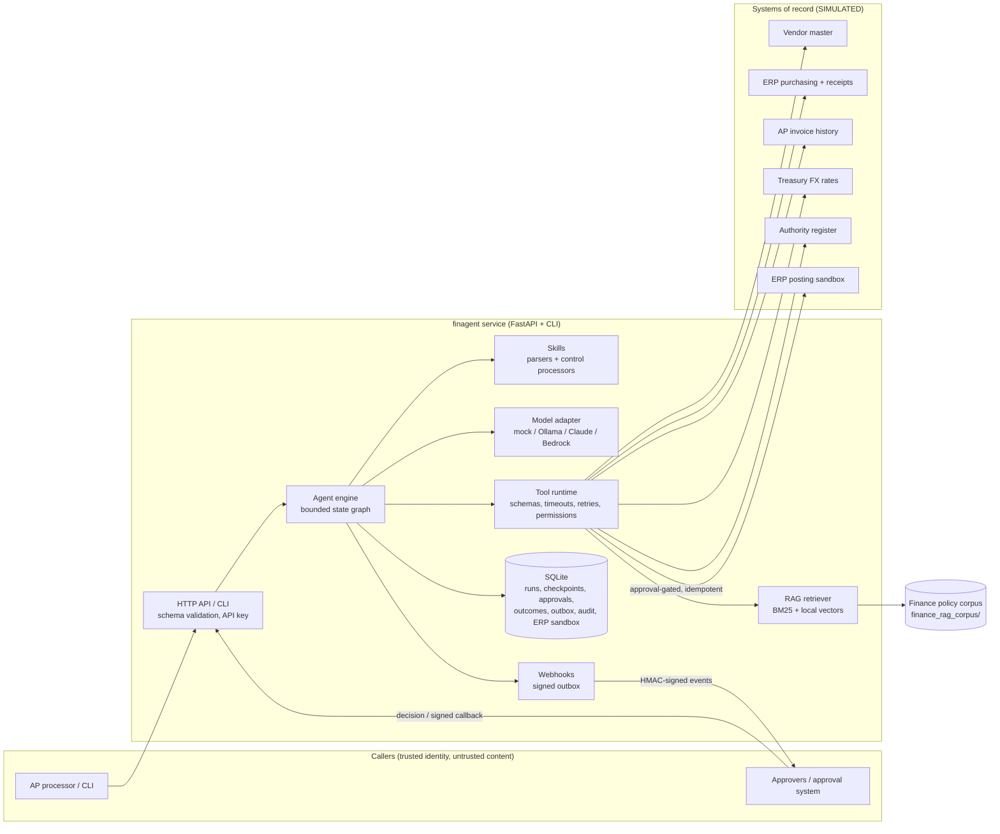
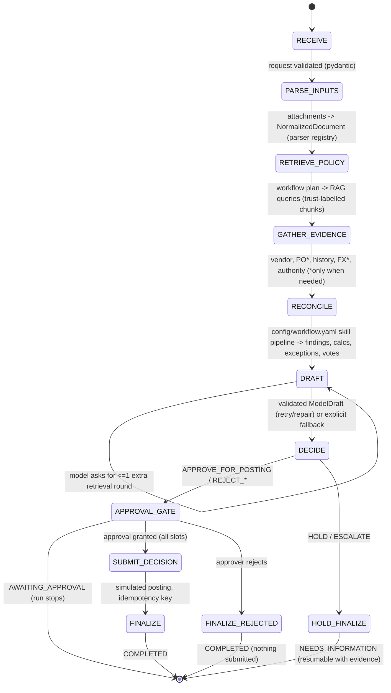
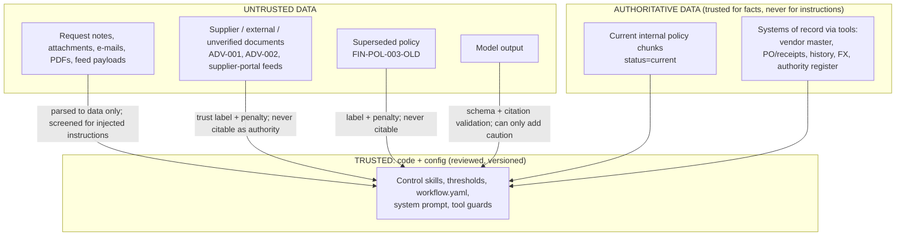
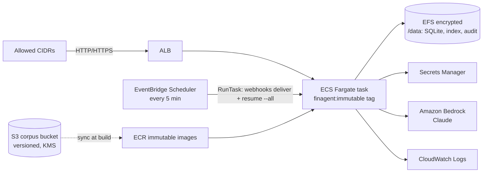
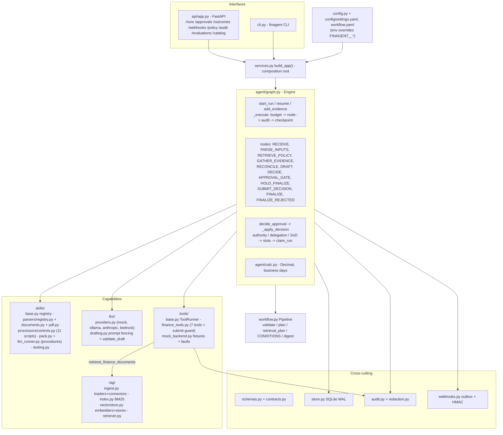
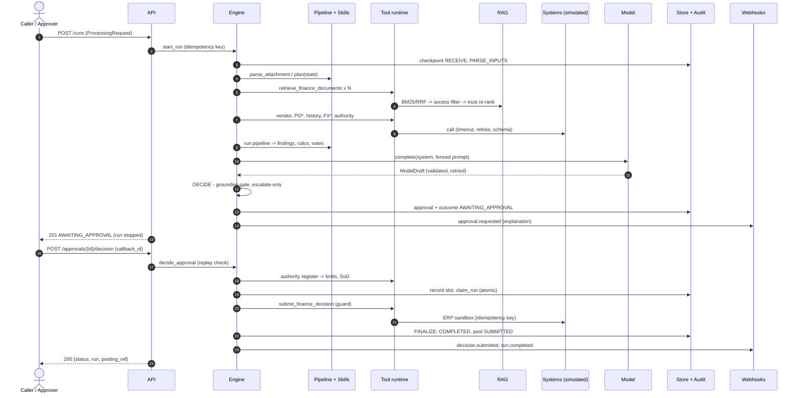
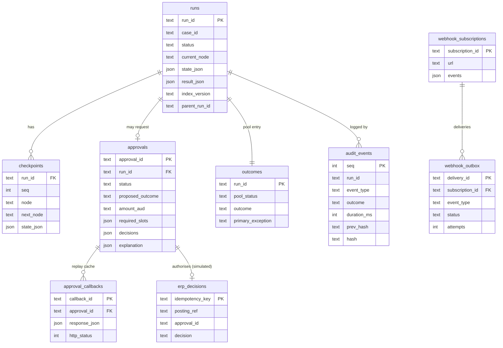
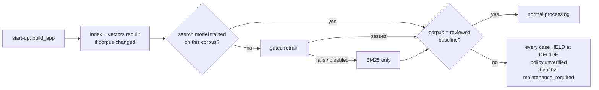
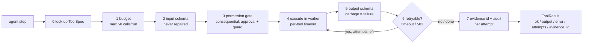

# Architecture design

> Printable diagrams (regenerate with `make diagrams`):
> - **High level:** [`diagrams/architecture.pdf`](diagrams/architecture.pdf): one page, the system context (every block with its framework / library). State graph, trust boundaries, RAG, policy changes, AWS and infrastructure are in [`diagrams/system_detailed_design.pdf`](diagrams/system_detailed_design.pdf); every step and flow is in [`diagrams/workflow_scenarios.pdf`](diagrams/workflow_scenarios.pdf) (pages 2-3).
> - **Detailed design:** [`diagrams/system_detailed_design.pdf`](diagrams/system_detailed_design.pdf): code map, module design, integration, inside each component, API walk-throughs, sequence, data model.
>
> Guided tour: [walkthrough.md](walkthrough.md).

`finagent` is an internal accounts-payable assistant. Given an invoice-processing request it:

1. retrieves policy evidence (RAG) and calls system tools only when the case needs them;
2. reconciles invoice, PO, receipt, vendor and policy evidence with deterministic code;
3. produces a typed, cited recommendation;
4. **stops for human approval** before any consequential decision;
5. resumes the same run on approval or rejection.

It persists every step so a run can be explained, reproduced and safely resumed.

> **Design principle:** the model *explains*; code *decides*.
> - All arithmetic, matching, thresholds and outcome selection are deterministic and policy-referenced.
> - The LLM writes the narrative and may only make an outcome **more** conservative.
> - Consequential actions are approval-gated, deny-by-default and idempotent.

---

## 1. System context

> Every infrastructure component (local and AWS), why it was chosen, and what to switch to when circumstances change: [infrastructure.md](infrastructure.md).

## 2. Agent state graph

The graph is explicit and bounded. It has no free-form agent loop.

- **Checkpoint after every node.** The node name, next node and full state are written to `checkpoints` and `runs` in one transaction.
  - A crash resumes at the next node: `finagent resume <run>` or `resume --all`. The scheduled task in AWS runs this.
- **Budgets per run:**
  - `agent.max_steps` (40)
  - `agent.max_tool_calls` (50: about 22 retrieval queries plus at most 8 evidence calls)
  - `agent.max_llm_calls` (6)

  Exceeding any of them produces an explicit `FAILED` run, never a partial decision.
- **Only one side-effecting node exists: `SUBMIT_DECISION`.** It runs only after `claim_run` atomically moves the run from `AWAITING_APPROVAL` to `RUNNING`, so a run can be resumed only once.

## 3. Component and configuration manifest

| Component | Implementation | Configuration | Real / simulated |
|---|---|---|---|
| API surface | FastAPI (`src/finagent/api/app.py`), Swagger at `/docs`, spec in `docs/api/openapi.yaml` | `app.api_key` | Real |
| CLI | `finagent` (`src/finagent/cli.py`) | — | Real |
| Agent runtime | Framework-free state graph (`agent/graph.py`) | `agent.*` | Real |
| Skill pipeline | `config/workflow.yaml` + registry (`workflow.py`, `skills/`) | stages, conditions, plugins | Real |
| Model | Provider adapter (`llm/providers.py`); prompts/validation in `llm/drafting.py` | `llm.provider`, `llm.providers.*` | `mock` is deterministic and simulated. `ollama`, `anthropic` and `bedrock` are **real** (external access). |
| Document store / index | Section-chunked corpus → BM25 JSON index + **SQLite vector store** (`rag/`) | `rag.sources`, `rag.mode`, `rag.vector.*` | Real (local) |
| Embeddings | `hash` (offline) or `ollama` (`nomic-embed-text`) | `rag.vector.embedder` | `hash` is real but lexical; `ollama` is real and semantic |
| Persistence | SQLite WAL (`store.py`): runs, checkpoints, approvals, callbacks, outcomes, outbox, audit, ERP sandbox | `app.data_dir` | Real (local) |
| Tools | `tools/finance_tools.py` + `tools/base.py` runtime | `tools.*` | Retrieval is **real**. Vendor, PO, history, FX, authority and posting are **simulated** (`mock_data/`). |
| Webhooks | Transactional outbox + HMAC-SHA256 (`webhooks.py`) | `webhooks.*` | Real HTTP delivery to whatever URL you subscribe |
| Audit | Hash-chained SQLite table + JSONL (`audit.py`), redacted | `app.audit_jsonl` | Real |
| Cloud | Terraform: ECS Fargate, ALB, EFS, ECR, S3, Secrets Manager, CloudWatch, EventBridge Scheduler, Bedrock IAM | `infra/terraform/*.tf` | Real IaC (validated; apply in your account) |

## 4. Trust boundaries

Enforcement points:

1. **Ingestion assigns trust from metadata, never from text.**
   - A feed can lower trust (`trust_ceiling`) but never raise it.
   - Access is filtered by classification per caller role (FIN-POL-010 s3).
2. **Prompt construction.**
   - Untrusted content is fenced in `<untrusted_case_text>` and `<retrieved_documents trust=...>`.
   - Contact details and bank numbers are redacted before they reach the prompt.
3. **`instruction_screen` skill.**
   - Embedded instructions are recorded as risk indicators (FIN-POL-005 s4). They are never followed.
4. **Model output validation.**
   - Output must pass the JSON schema.
   - Citations must come from the supplied ids, and superseded or untrusted ids are rejected.
   - A policy guard blocks any relaxation of the outcome (`model.override_blocked`).
5. **Grounding gate.**
   - Every finding must cite a *retrieved*, authoritative chunk. Otherwise an approval is downgraded to a hold.
6. **Consequential tool guard.**
   - `submit_finance_decision` requires an APPROVED approval whose outcome, amount, currency and decision verb match exactly.
   - It also requires an idempotency key derived from the approval.
7. **Approver validation.** Every approver is checked for:
   - authority (register v4.x limits and flags), and expired delegations;
   - segregation of duties: vendor creator, recent vendor changer, requester, and receipter above AUD 25k.

## 5. Data contracts (extensible, versioned)

| Contract | Schema id | Producer | Consumer |
|---|---|---|---|
| `ProcessingRequest` | `processing_request.v1` | API / CLI | engine |
| `NormalizedDocument` | `finagent.document/1` | parser registry (JSON, text, CSV, e-mail, PDF, plugins) | control skills |
| `CorpusDocument` | `finagent.corpus/1` | corpus loaders / connectors (md, json, txt, pdf, http feed, plugins) | chunker → BM25 + vectors |
| `ModelDraft` | `model_draft.v1` | LLM | validator → decision |
| `FinalResult` | `final_result.v1` | engine | API, outcome pool, webhooks |

JSON Schemas are in `contracts/`. Evolution rules are in [extending.md](extending.md):

- changes within a major version are additive only;
- source-specific fields go under namespaced `x-<source>.*` extension keys;
- every record carries provenance.

## 6. Persistence model

Full column-level detail, JSON structures, status transitions and example queries: [database.md](database.md).

| Table | Purpose |
|---|---|
| `runs` | One row per run attempt: status, current node, request, state, result, config manifest, index version, parent run (evidence resubmission) |
| `checkpoints` | Append-only node history per run (replay / explain) |
| `approvals` | Approval request with slots, decisions (approver, role, limit, register version, timestamp) and the full explanation shown to approvers |
| `approval_callbacks` | Callback-id → stored response (replay-safe duplicate callbacks) |
| `outcomes` | Outcome pool (`AWAITING_APPROVAL`, `SUBMITTED`, `HELD`, `ESCALATED`, `REJECTED_BY_APPROVER`, `FAILED`) |
| `webhook_subscriptions`, `webhook_outbox` | Event feed and delivery state |
| `audit_events` | Hash-chained audit trail |
| `erp_decisions` | **Simulated** ERP posting sandbox keyed by idempotency key |
| `eval_results` | Evaluation history |

Production mapping:

- **Runs, approvals and outcomes** → Postgres (RDS / Aurora) with the same transactional semantics. A row lease replaces `claim_run`.
- **Audit** → append-only table plus an S3 Object Lock export.
- **Outbox** → SQS / EventBridge.
- **Vectors** → pgvector / OpenSearch through the `VectorStore` adapter.

## 7. Deployment views

- **Local:** `scripts/dev/setup.sh` and `finagent serve`, or `make up` for everything in Docker (agent + skill models, one command on macOS / Linux / Windows). Details: [env/dev.md](env/dev.md).
- **AWS:** see [env/aws.md](env/aws.md).
  - ALB (CIDR-restricted, optional TLS) → ECS Fargate with one task.
  - EFS (encrypted) for SQLite, the index and the audit JSONL.
  - Secrets Manager for the webhook secret and API key; Bedrock for the model under a least-privilege task role.
  - CloudWatch logs.
  - An EventBridge Scheduler task drains the webhook outbox and resumes interrupted runs every 5 minutes.

## 8. finagent service: detailed design

The printable versions are pages 2-3 of [`diagrams/workflow_scenarios.pdf`](diagrams/workflow_scenarios.pdf) and the state-graph page of [`diagrams/system_detailed_design.pdf`](diagrams/system_detailed_design.pdf).

### 8.1 Module design (inside the container)

### 8.2 Request lifecycle

### 8.3 Persistence data model

## 9. Policy changes (maintenance releases, never live)

A running service never changes its policy or index. A policy change is a release: edit the policy, update the
controls / skills / `config/policy_parameters.yaml` with tests, `make test eval`,
`finagent policy baseline --reviewer <id> --note "<why>"`, then deploy / restart
([governance.md](governance.md), system_detailed_design.pdf sections 4 and 14).

| Module | Role |
|---|---|
| `governance/params.py` | catalog of every policy number the hand-written controls use (value, source section); values in `config/policy_parameters.yaml`; `P(ev, name)` replaces literals in `controls.py` |
| `governance/baseline.py` | `PolicyBaseline`: corpus section hashes vs `config/policy_baseline.yaml`; `status()` (ok / maintenance_required), `write_baseline()` |

## 10. Integration: where external data plugs in

[system_detailed_design.pdf](diagrams/system_detailed_design.pdf) section 4 (integration lanes) and section 5 (inside the tool runtime); sections 1–2 map every code component, 6–10 show inside each component, 11–12 trace the API calls. Four routes; **only the plug-in point changes
per source**. The contract and the runtime checks stay fixed.

| Route | Source today | Production options | Plug-in point | Contract | Runtime checks | Step |
|---|---|---|---|---|---|---|
| 1 Case request & documents (untrusted) | `POST /runs` / CLI with attachments; approval decisions incl. signed callbacks (**real**) | XML/UBL, Word, OCR | `@register_parser` | `ProcessingRequest`, `finagent.document/1`, `ApprovalDecisionIn` | request schema (422), max files, idempotency key, HMAC + replay check, text fenced as data, redaction | RECEIVE / PARSE_INPUTS |
| 2 Reference systems (authoritative) | `mock_data/*.json` via `MockBackend` (**simulated**) | REST APIs (SAP / Oracle / Coupa), **MCP servers**, read-only DB, CSV/Excel exports | one backend class passed to `build_tools(..., backend)` | `VendorRecord`, `PurchaseOrder`, `InvoiceHistoryOutput`, `FxRate`, `AuthorityRegister` | tool runtime (below) | GATHER_EVIDENCE |
| 3 Policy sources | Markdown folder, HTTP feed (**real**) | S3 / SharePoint / Confluence connectors | `@register_connector`, `@register_loader` | `finagent.corpus/1` | re-index at start-up, access filter, trust re-rank, policy baseline check | RETRIEVE_POLICY |
| 4 Outputs | `erp_decisions` table (**simulated**), webhooks, outcome pool, audit (**real**) | ERP sandbox / UAT API; SQS / EventBridge / SIEM | same backend pattern / webhook channel | `SubmitDecisionOutput` | submit guard (7 checks) + idempotency | APPROVAL_GATE -> SUBMIT_DECISION |

### Inside the tool runtime (`tools/base.py`, `ToolRunner.call`)

- `ok=False` is not an exception: the control reports **UNKNOWN** and the case is held with the missing item listed.
- Budget exhaustion and permission denial **raise**: the run fails, or the submit is refused.
- Permissions on each `ToolSpec` (`read:vendor_master` …) are declared labels, shown in `/catalog/tools`, to map to
  IAM roles or service accounts. Enforcement in the POC is the consequential flag plus the guard.
- A timed-out call is abandoned, not killed. A real backend must set its own HTTP or database timeouts.
- Settings: `tools.default_timeout_s`, `tools.max_attempts`, `tools.backoff_base_s`, `tools.overrides.<tool>.*`,
  `agent.max_tool_calls`.
