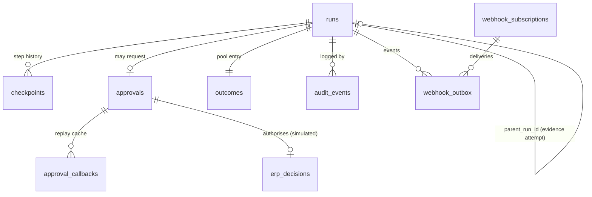
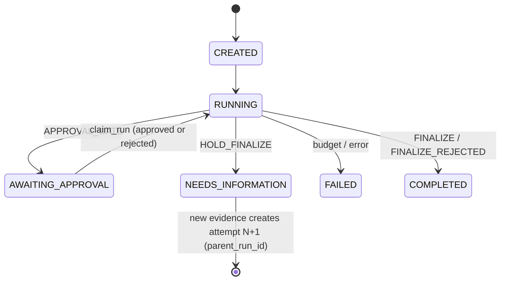

# Database structure

_Generated by `python scripts/build_db_doc.py` from the real schema in `src/finagent/store.py`. Do not edit by hand._

The run store is a single SQLite file, **`data/finagent.db`** (WAL mode). It holds everything needed to explain, reproduce and resume a run, and the simulated ERP sandbox. Policy search uses two more files under `data/index/`.

## Tables at a glance

| Table | Role | Rows now |
|---|---|---|
| [`runs`](#runs) | Run state machine | 107 |
| [`checkpoints`](#checkpoints) | Step history | 913 |
| [`approvals`](#approvals) | Human approval requests | 59 |
| [`approval_callbacks`](#approval_callbacks) | Duplicate-callback cache | 36 |
| [`outcomes`](#outcomes) | Outcome pool | 107 |
| [`audit_events`](#audit_events) | Audit trail | 6354 |
| [`webhook_subscriptions`](#webhook_subscriptions) | Webhook subscribers | 2 |
| [`webhook_outbox`](#webhook_outbox) | Event feed + delivery queue | 359 |
| [`erp_decisions`](#erp_decisions) | Simulated ERP posting sandbox | 17 |
| [`eval_results`](#eval_results) | Evaluation history | 45 |

## Relationships



Foreign keys are logical (enforced in code, not as SQLite `FOREIGN KEY` clauses) to keep the audit and outbox append-only and
independent of run deletion. The production Postgres DDL below declares them.

## Tables

### `runs`

**Run state machine.** One row per workflow run (attempt). The current status, the step it will run next, and the full persisted state, so any run can be explained, reproduced and resumed.

| Column | Type | Key / null | Meaning |
|---|---|---|---|
| `run_id` | TEXT | PK | Run id (`run-<12 hex>`). Primary key; correlation id for audit, webhooks and diagrams. |
| `case_id` | TEXT | NOT NULL | Business case id from the request (e.g. `FIN-001`). Several runs per case are possible (evidence attempts). |
| `request_idempotency_key` | TEXT | nullable | Client `Idempotency-Key` (POST /runs). Unique: a repeat returns the same run. |
| `status` | TEXT | NOT NULL | `CREATED` → `RUNNING` → `AWAITING_APPROVAL` \| `NEEDS_INFORMATION` \| `COMPLETED` \| `FAILED` (see Status values). |
| `current_node` | TEXT | nullable | Next graph step to execute (NULL when stopped). `resume` continues from here. |
| `request_json` | TEXT | NOT NULL | The validated `ProcessingRequest` (incl. attachments). |
| `state_json` | TEXT | NOT NULL | Full working state after the last checkpoint (see JSON: runs.state_json). |
| `result_json` | TEXT | nullable | Typed `FinalResult` once DECIDE has run (see JSON: runs.result_json). |
| `error` | TEXT | nullable | Failure reason when status = FAILED. |
| `config_manifest` | TEXT | nullable | Non-secret config snapshot at start (model provider/model, RAG mode, budgets, workflow file). |
| `index_version` | TEXT | nullable | Hash of the policy corpus the run searched (reproducibility). |
| `parent_run_id` | TEXT | nullable | Previous attempt when new evidence was added (FIN-POL-007 s5); NULL for first attempts. |
| `attempt` | INTEGER | NOT NULL default 1 | 1 for the first run of a case, +1 per evidence resubmission. |
| `version` | INTEGER | NOT NULL default 0 | Optimistic version counter, +1 on every write. |
| `created_at` | TEXT | NOT NULL | ISO-8601 timestamp (frozen demo clock unless app.fixed_now is null). |
| `updated_at` | TEXT | NOT NULL | Last change. |

Indexes: `ix_runs_status` (status); `ix_runs_case` (case_id); `sqlite_autoindex_runs_2` (request_idempotency_key) UNIQUE - automatic for PK/UNIQUE; `sqlite_autoindex_runs_1` (run_id) UNIQUE - automatic for PK/UNIQUE

### `checkpoints`

**Step history.** Append-only history: one row per completed graph step with the full state at that moment. Used for resume, the run diagram path and forensic replay.

| Column | Type | Key / null | Meaning |
|---|---|---|---|
| `run_id` | TEXT | PK | Run (FK → runs.run_id). |
| `seq` | INTEGER | PK | 1, 2, 3 … per run (part of the primary key). |
| `node` | TEXT | NOT NULL | Step just completed (RECEIVE, PARSE_INPUTS, …, FINALIZE). |
| `next_node` | TEXT | nullable | Step that will run next (NULL = stop). |
| `state_json` | TEXT | NOT NULL | State snapshot after the step. |
| `created_at` | TEXT | NOT NULL | Timestamp. |

Indexes: `sqlite_autoindex_checkpoints_1` (run_id, seq) UNIQUE - automatic for PK/UNIQUE

### `approvals`

**Human approval requests.** At most one per run, created at APPROVAL_GATE for consequential outcomes (posting or rejecting). Holds what approvers see and every decision made.

| Column | Type | Key / null | Meaning |
|---|---|---|---|
| `approval_id` | TEXT | PK | `apr-<12 hex>`. Primary key. |
| `run_id` | TEXT | NOT NULL | Run (FK, unique - one approval per run). |
| `case_id` | TEXT | NOT NULL | Business case id. |
| `status` | TEXT | NOT NULL | `PENDING` → `APPROVED` \| `REJECTED`. |
| `decision_type` | TEXT | NOT NULL | `POST` (approve for posting) or `REJECT` (confirm a rejection). |
| `proposed_outcome` | TEXT | NOT NULL | The recommendation being approved. |
| `amount` | TEXT | NOT NULL | Invoice amount (decimal as text). |
| `currency` | TEXT | NOT NULL | Invoice currency. |
| `amount_aud` | TEXT | NOT NULL | Amount in AUD used for the authority limit. |
| `required_slots` | TEXT | NOT NULL | JSON list of slots that must be filled (see JSON: approvals). |
| `decisions` | TEXT | NOT NULL | JSON list of recorded decisions (approver, role, limit, register version, comment, channel, time). |
| `explanation` | TEXT | NOT NULL | JSON explanation shown to approvers: summary, exceptions, findings, calculations, citations, constraints. |
| `created_at` | TEXT | NOT NULL | Timestamp. |
| `resolved_at` | TEXT | nullable | When it became APPROVED / REJECTED. |

Indexes: `sqlite_autoindex_approvals_2` (run_id) UNIQUE - automatic for PK/UNIQUE; `sqlite_autoindex_approvals_1` (approval_id) UNIQUE - automatic for PK/UNIQUE

### `approval_callbacks`

**Duplicate-callback cache.** Replay protection: the stored response for each approval callback, keyed by approval + callback id. A repeat returns the same response with `replayed: true` and no side effects.

| Column | Type | Key / null | Meaning |
|---|---|---|---|
| `callback_id` | TEXT | PK | `<approval_id>:<callback_id>` (scoped per approval). Primary key. |
| `approval_id` | TEXT | NOT NULL | Approval (FK). |
| `request_fingerprint` | TEXT | NOT NULL | `<decision>:<approver_id>` of the original callback. |
| `response_json` | TEXT | NOT NULL | Exact response returned the first time. |
| `http_status` | INTEGER | NOT NULL | HTTP status returned the first time. |
| `received_at` | TEXT | NOT NULL | Timestamp. |

Indexes: `sqlite_autoindex_approval_callbacks_1` (callback_id) UNIQUE - automatic for PK/UNIQUE

### `outcomes`

**Outcome pool.** Current business status of every run - what dashboards and `GET /outcomes` read.

| Column | Type | Key / null | Meaning |
|---|---|---|---|
| `run_id` | TEXT | PK | Run (PK/FK). |
| `case_id` | TEXT | NOT NULL | Business case id. |
| `outcome` | TEXT | nullable | Recommendation (APPROVE_FOR_POSTING, HOLD_FOR_INFORMATION, …). |
| `pool_status` | TEXT | NOT NULL | `AWAITING_APPROVAL` \| `SUBMITTED` \| `HELD` \| `ESCALATED` \| `REJECTED_BY_APPROVER` \| `FAILED` \| `SUPERSEDED` (resumed; payload.superseded_by = newer run). |
| `primary_exception` | TEXT | nullable | Main exception category (FIN-POL-007) or NULL. |
| `amount` | TEXT | nullable | Invoice amount. |
| `currency` | TEXT | nullable | Currency. |
| `summary` | TEXT | nullable | One-line summary. |
| `payload` | TEXT | NOT NULL | JSON: next action, exceptions / submission / decisions depending on status. |
| `updated_at` | TEXT | NOT NULL | Last change. |

Indexes: `ix_outcomes_status` (pool_status); `sqlite_autoindex_outcomes_1` (run_id) UNIQUE - automatic for PK/UNIQUE

### `audit_events`

**Audit trail.** Append-only, hash-chained, redacted log of every operation (tools, model, skills, approvals, webhooks, API). `finagent audit-verify` recomputes the chain.

| Column | Type | Key / null | Meaning |
|---|---|---|---|
| `seq` | INTEGER | PK | Global sequence (autoincrement). Order of the chain. |
| `event_id` | TEXT | NOT NULL | `evt-<16 hex>`, unique. |
| `run_id` | TEXT | nullable | Run (nullable for non-run events such as webhook subscriptions). |
| `correlation_id` | TEXT | nullable | Defaults to run_id. |
| `ts` | TEXT | NOT NULL | Timestamp. |
| `event_type` | TEXT | NOT NULL | e.g. `tool.call`, `model.override_blocked`, `approval.denied` (see docs/audit.md). |
| `node` | TEXT | nullable | Graph step, if any. |
| `tool` | TEXT | nullable | Tool or skill name, if any. |
| `outcome` | TEXT | nullable | e.g. ok, retrying, failed, blocked, forbidden. |
| `duration_ms` | INTEGER | nullable | Duration where measured. |
| `attempt` | INTEGER | nullable | Retry attempt number for tools / model calls. |
| `actor` | TEXT | nullable | `system`, an approver id, or the requester. |
| `details` | TEXT | NOT NULL | JSON, redacted (bank numbers → ****1234, e-mails, phones, secrets masked). |
| `prev_hash` | TEXT | NOT NULL | Hash of the previous event (GENESIS = 64 zeros). |
| `hash` | TEXT | NOT NULL | sha256(prev_hash + canonical JSON of this event). |

Indexes: `ix_audit_run` (run_id); `sqlite_autoindex_audit_events_1` (event_id) UNIQUE - automatic for PK/UNIQUE

### `webhook_subscriptions`

**Webhook subscribers.** Who receives status events.

| Column | Type | Key / null | Meaning |
|---|---|---|---|
| `subscription_id` | TEXT | PK | `sub-<10 hex>`. Primary key. |
| `url` | TEXT | NOT NULL | Receiver URL. |
| `events` | TEXT | NOT NULL | JSON list of event types or `["*"]`. |
| `active` | INTEGER | NOT NULL default 1 | 1 = active, 0 = unsubscribed. |
| `created_at` | TEXT | NOT NULL | Timestamp. |

Indexes: `sqlite_autoindex_webhook_subscriptions_1` (subscription_id) UNIQUE - automatic for PK/UNIQUE

### `webhook_outbox`

**Event feed + delivery queue.** Transactional outbox: one row per event per subscriber (plus one `NO_SUBSCRIBER` row so the feed is complete). Retried until DELIVERED or DEAD.

| Column | Type | Key / null | Meaning |
|---|---|---|---|
| `delivery_id` | TEXT | PK | `dlv-<12 hex>`. Primary key. |
| `subscription_id` | TEXT | nullable | Subscriber (FK) or NULL for feed-only rows. |
| `event_type` | TEXT | NOT NULL | e.g. approval.requested, run.completed. |
| `run_id` | TEXT | nullable | Run. |
| `payload` | TEXT | NOT NULL | JSON envelope {event_type, event_id, run_id, occurred_at, data}. |
| `status` | TEXT | NOT NULL | `PENDING` \| `DELIVERED` \| `FAILED` \| `DEAD` \| `NO_SUBSCRIBER`. |
| `attempts` | INTEGER | NOT NULL default 0 | Delivery attempts so far. |
| `last_error` | TEXT | nullable | Last delivery error. |
| `created_at` | TEXT | NOT NULL | Timestamp. |
| `delivered_at` | TEXT | nullable | Delivery time. |

Indexes: `sqlite_autoindex_webhook_outbox_1` (delivery_id) UNIQUE - automatic for PK/UNIQUE

### `erp_decisions`

**Simulated ERP posting sandbox.** Stands in for the accounting system. Only `submit_finance_decision` writes here, only after approval; the idempotency key makes a second posting impossible.

| Column | Type | Key / null | Meaning |
|---|---|---|---|
| `idempotency_key` | TEXT | PK | `idem-<32 hex>` = hash(run, approval, outcome, amount). Primary key. |
| `posting_ref` | TEXT | NOT NULL | `SIM-POST-…` / `SIM-REJECT-…`, unique. |
| `run_id` | TEXT | NOT NULL | Run. |
| `case_id` | TEXT | NOT NULL | Case. |
| `approval_id` | TEXT | NOT NULL | Authorising approval. |
| `decision` | TEXT | NOT NULL | `POST` or `REJECT`. |
| `payload` | TEXT | NOT NULL | Submitted, validated arguments (JSON). |
| `recorded_at` | TEXT | NOT NULL | Timestamp. |

Indexes: `sqlite_autoindex_erp_decisions_2` (posting_ref) UNIQUE - automatic for PK/UNIQUE; `sqlite_autoindex_erp_decisions_1` (idempotency_key) UNIQUE - automatic for PK/UNIQUE

### `eval_results`

**Evaluation history.** One row per `finagent eval` / `POST /evaluations/run`.

| Column | Type | Key / null | Meaning |
|---|---|---|---|
| `eval_id` | TEXT | PK | `eval-<10 hex>`. |
| `created_at` | TEXT | NOT NULL | Timestamp. |
| `summary` | TEXT | NOT NULL | JSON: pass/fail counts, RAG metrics, audit chain check. |
| `results` | TEXT | NOT NULL | JSON: every scenario with every check. |

Indexes: `sqlite_autoindex_eval_results_1` (eval_id) UNIQUE - automatic for PK/UNIQUE


## JSON column structures

### `runs.state_json` (working state, saved after every step)

| Key | Content |
|---|---|
| `request` | the validated request |
| `budget` | `{steps, tool_calls, llm_calls}` used so far (limits in settings `agent.*`) |
| `actions` | every tool call / approval request / submission: `{action, tool, at, detail{ok, attempts, duration_ms, evidence_id, error}}` |
| `notes`, `trace` | rule notes; **reasoning trace** `{at, step, actor, decision, reason, refs}` (see `finagent explain`) |
| `docs`, `invoice` | parsed attachments (`finagent.document/1`) and the primary invoice / credit note |
| `planned_skills`, `workflow` | controls selected for this case; workflow name, version, digest |
| `retrieval` | `{index_version, queries[{query, reason, returned[]}], chunks{chunk_id: chunk}}` |
| `evidence` | `{vendor, po, history, original_invoice_records, fx, authority, errors{...}}` from the tools |
| `skills` | per control: findings, calculations, exceptions, facts, unknowns, risk_indicators, votes, approvals, data |
| `rules_outcome`, `outcome` | most conservative vote; final recommendation |
| `model`, `draft` | provider, model, attempts (valid?, errors, usage); validated model draft |
| `result` | same as `result_json` |
| `approval_id`, `submission` | link to the approval; simulated posting response |

### `runs.result_json` (typed `FinalResult`, `contracts/final_result.v1.schema.json`)

`run_id, case_id, status, recommendation{outcome, primary_exception, confidence, next_action, summary, required_approvals[],
amount_aud, proposed_payment_date}, sourced_facts[], calculations[], inferences[], unknowns[], policy_findings[], exceptions[],
risk_indicators[], actions_taken[], approval, submission, reasoning[], model, retrieval, policy{baseline_reviewed_by,
baseline_reviewed_at, unverified_sections[]}`

### `approvals`

- `required_slots`: `[{slot: primary | financial_control | procurement_governance, description, min_limit_aud, requires_flag}]`
- `decisions`: `[{slot, approver_id, role, applicable_limit_aud, register_version, decision, comment, channel, decided_at, case_id}]`
- `explanation`: `{case_id, vendor_id, invoice_ref, amount, currency, amount_aud, proposed_outcome, what_approval_does, summary,
  confidence, primary_exception, exceptions[], failed_or_unknown_findings[], key_findings[], key_calculations[], risk_indicators[],
  unknowns[], citations[], required_approvals[], constraints{excluded_approvers, requester_id, po_requester_id, receipters,
  distinct_roles_required, register_version}, proposed_payment_date}`

### `webhook_outbox.payload`

`{event_type, event_id, run_id, occurred_at, data}`. `data` for `approval.requested` carries `{approval_id, explanation, decide_url}`.


## Status values and transitions



| runs.status | outcomes.pool_status | approvals.status |
|---|---|---|
| AWAITING_APPROVAL | AWAITING_APPROVAL | PENDING |
| COMPLETED (posted / rejection recorded) | SUBMITTED | APPROVED |
| COMPLETED (approver said no) | REJECTED_BY_APPROVER | REJECTED |
| NEEDS_INFORMATION (hold) | HELD | — |
| NEEDS_INFORMATION (escalation) | ESCALATED | — |
| FAILED | FAILED | — |


## Transactions and concurrency

- **WAL mode**: readers never block the writer; `busy_timeout` = 30 s.
- **`BEGIN IMMEDIATE`** wraps every multi-statement write (approval decisions, checkpoints, ERP posting, outbox). Two approval
  callbacks arriving at once are serialised; the second sees the first's result.
- **`claim_run`** moves `AWAITING_APPROVAL → RUNNING` (or `CREATED/RUNNING → RUNNING` on resume) atomically, so a run can never be
  resumed twice.
- **Checkpoint** = insert into `checkpoints` + update `runs` in one transaction; webhooks are sent only after it commits.
- **Single writer**: one process/container (ECS `desired_count = 1`). Move to Postgres before running several workers.


## Files next to the database (`data/`)

| File | Structure | Purpose |
|---|---|---|
| `index/bm25_index.json` | `{index_version, k1, b, chunks[{chunk_id, document_id, title, doc_type, version, section, status, effective_date, classification, owner, trust, text, index_text, tags, source_path, content_sha256}]}` | policy search index; rebuilt by `finagent ingest` or automatically when the corpus changes |
| `index/vectors.db` (SQLite) | `vectors(chunk_id PK, document_id, classification, trust, index_version, embedder, dim, vector BLOB float32)` | embedding vectors for semantic search (swap via `rag.vector.store`) |
| `audit.jsonl` | one audit event per line (same fields as `audit_events`) | ship to a SIEM / CloudWatch / S3 |
| `eval/latest.json`, `eval/diagrams/` | last evaluation report; per-scenario diagrams | test history |
| `diagrams/` | per-run diagrams (`<CASE>_<run_id>.png/pdf/svg`) + `index.html` | run history pictures |
| `run/finagent.pid`, `run/finagent.log` | local service process id and log | `make start/stop/logs` |

The approval inbox, mock systems of record and training data live outside `data/` (`mock_data/`, `training/`).


## Useful queries

Open with `sqlite3 data/finagent.db` (or any SQLite browser such as DB Browser for SQLite / DBeaver).

```sql
-- current outcome pool
SELECT pool_status, COUNT(*) FROM outcomes GROUP BY pool_status;

-- what is waiting for which approver role
SELECT a.approval_id, a.case_id, a.amount_aud, json_extract(s.value, '$.description') AS needs
FROM approvals a, json_each(a.required_slots) s WHERE a.status = 'PENDING';

-- path a run took (exit step = last row)
SELECT seq, node, next_node FROM checkpoints WHERE run_id = 'run-…' ORDER BY seq;

-- every refused approval attempt and why
SELECT run_id, actor, json_extract(details, '$.reasons') FROM audit_events WHERE event_type = 'approval.denied';

-- tool retries / failures in the last runs
SELECT run_id, tool, attempt, outcome, duration_ms FROM audit_events
WHERE event_type = 'tool.call' AND outcome IN ('retrying', 'failed') ORDER BY seq DESC LIMIT 50;

-- postings (simulated) and the approval that authorised each
SELECT e.posting_ref, e.decision, e.case_id, a.decisions FROM erp_decisions e JOIN approvals a USING (approval_id);

-- runs whose model proposal was blocked by the policy guard
SELECT DISTINCT run_id FROM audit_events WHERE event_type = 'model.override_blocked';
```

The same information is available without SQL: `GET /runs`, `/runs/{id}`, `/runs/{id}/reasoning`, `/outcomes`, `/approvals`,
`/runs/{id}/audit`, `/webhooks/events`, or `finagent runs | explain | audit`.


## Production mapping (PostgreSQL)

| SQLite | PostgreSQL |
|---|---|
| `TEXT` JSON columns | `JSONB` (+ GIN indexes on `outcomes.payload`, `audit_events.details` if queried) |
| `TEXT` timestamps (ISO-8601) | `TIMESTAMPTZ` |
| decimal amounts as `TEXT` | `NUMERIC(14,2)` |
| `BEGIN IMMEDIATE` | `SELECT … FOR UPDATE` on `approvals` / `runs` |
| `claim_run` status check | `UPDATE runs SET status='RUNNING', lease_owner=$1, lease_until=now()+interval '5 min' WHERE run_id=$2 AND status=ANY($3)` |
| logical FKs | declared `FOREIGN KEY … ON DELETE RESTRICT` (audit/outbox keep `run_id` without FK) |
| `audit_events` | append-only table (revoke UPDATE/DELETE) + periodic export to S3 Object Lock |
| `webhook_outbox` | outbox table drained by a worker into SQS / EventBridge |
| `vectors.db` | `pgvector` table via the VectorStore adapter (docs/rag_pipeline.md) |

Retention: invoice, approval and audit records are kept 7 years after the financial year (FIN-POL-010 s1); legal hold pauses deletion.

