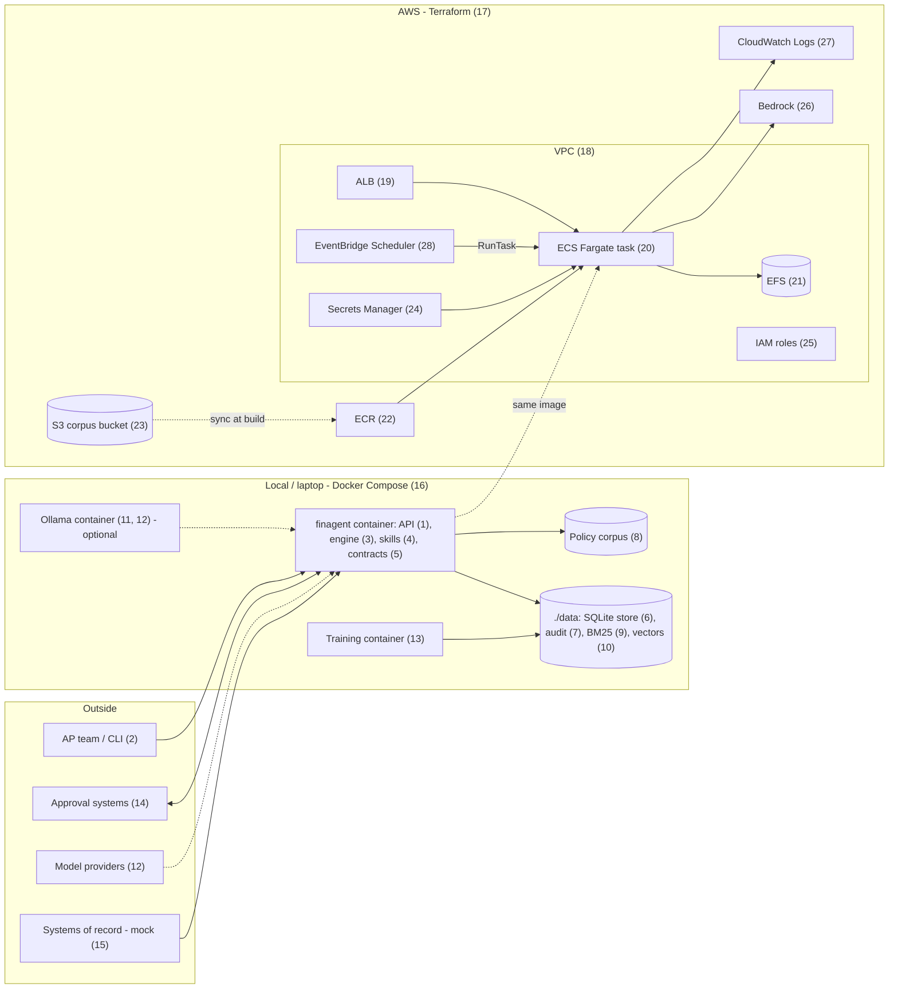

# Infrastructure: components, reasons and alternatives

_Generated from `scripts/infra_catalog.py` (also used by pages 19-24 of [diagrams/system_detailed_design.pdf](diagrams/system_detailed_design.pdf) and the presentation). Regenerate: `make diagrams`._

## Diagram

## Component catalogue

| # | Component | Layer | What it does | Why we chose it | Alternatives -> when to switch |
|---|---|---|---|---|---|
| 1 | **Python 3.13 + FastAPI + uvicorn** | App | HTTP API (Swagger /docs), request validation, webhook endpoints. | Typed contracts (pydantic) give validation and OpenAPI for free; one language for agent, RAG and ML tooling. | Flask/Django -> team standard; TypeScript (NestJS) -> JS-only team; gRPC -> internal service-to-service only. |
| 2 | **finagent CLI + devctl / make** | App | Operate every workflow step and the dev environment from a terminal (Windows, macOS, Linux). | Scriptable, testable, no UI needed (brief: 'no user interface required'). | Typer/Click -> richer CLI UX; an internal web console -> non-technical operators. |
| 3 | **Agent engine (framework-free state graph)** | App | 12 checkpointed steps, budgets, approval gate, resume, exactly-once posting. | Safety guarantees (deny-by-default, escalate-only model, grounding gate) stay explicit and testable in ~1k lines. | LangGraph -> many agents / dynamic branching; AWS Step Functions -> managed durable workflow with human-approval task tokens; Temporal -> long-running cross-service workflows at scale. |
| 4 | **Skill packs + runner + config/workflow.yaml** | App | every skill = deterministic script; 4 ask fixed SKILL.md questions (small model, large second opinion, code decides); order in config. | Judgement where rules are brittle, exact maths in code; questions editable without code; any model answers the same questions. | Rules engine (Drools / OPA) -> rules owned by a separate policy team; DMN tables -> business-edited decisions. |
| 5 | **Pydantic data contracts (JSON Schema)** | App | Versioned request, document, corpus, model-draft and result schemas. | Strict validation at every boundary; schemas exported for producers. | Avro/Protobuf + schema registry -> event-streaming (Kafka) integration. |
| 29 | **Policy baseline check** | App | At start-up compares the policy text with the reviewed baseline; any difference holds every case until a maintenance release. | Policy changes are tested releases signed off by a named person, never live; a running service never changes its rules. | OPA / Rego or DMN decision tables -> a separate policy team owns rules; a rules engine (Drools) -> very large rule sets. |
| 6 | **SQLite (WAL) run store** | Data | Runs, checkpoints, approvals, callbacks, outcome pool, outbox, audit, ERP sandbox. | Zero-ops, transactional (BEGIN IMMEDIATE serialises approvals); perfect for POC and single instance. | PostgreSQL / Aurora -> >1 worker, HA, reporting; DynamoDB -> serverless high scale (use conditional writes for claim_run). |
| 7 | **Hash-chained audit (SQLite + JSONL)** | Data | Every event with timestamps, run id, outcome, duration; redacted; tamper-evident chain. | Explain + reproduce any run; verify integrity with one command; no extra service. | S3 Object Lock (compliance mode) -> regulator-grade retention; SIEM (Splunk, Datadog, CloudWatch) -> central monitoring. |
| 8 | **Policy corpus (Markdown) + connectors** | Data | Source documents with front-matter metadata; local folder, HTTP feed, plug-ins. | Plain files are reviewable in git; metadata drives trust and versioning. | SharePoint / Confluence / S3 connector -> policies owned elsewhere; document management system -> formal approval workflow. |
| 9 | **BM25 index (JSON)** | RAG | Lexical search over section chunks; deterministic; exact finance terms. | Exact finance terms and ids; deterministic; combined with the fine-tuned embedder (hybrid) it reaches R@5 0.90 vs 0.71 alone. | OpenSearch / Elasticsearch -> thousands of documents, filters, native hybrid search. |
| 10 | **Vector store (SQLite) + VectorStore adapter** | RAG | Embeddings stored locally; cosine search; 4-method adapter interface. | POC needs no vector DB; adapter gives a one-file path to a dedicated store. | pgvector -> already on Postgres; OpenSearch k-NN -> already on OpenSearch; Qdrant / Pinecone -> millions of chunks; Bedrock Knowledge Bases -> fully managed RAG. |
| 11 | **Embedding model (hash | fine-tuned bge-small | Ollama)** | RAG | Turns text into vectors for semantic search. | Fine-tuned bge-small (enabled, hybrid w=4): R@5 0.90 vs 0.71 BM25, passes the accuracy gate; CPU-trainable in Docker in ~8 min. | Bedrock Titan / Cohere Embed -> managed, no training; larger bge-base -> more accuracy if CPU/GPU budget allows. |
| 12 | **LLM adapter (mock | Ollama | Claude API | Bedrock)** | Model | Answers skill questions (small + large) and writes the cited narrative; may only make the outcome more cautious. | Provider switch is config only; mock keeps tests deterministic and free. | Bedrock in-region -> data residency in AWS; Claude API (claude-opus-5-5) -> best quality; claude-haiku-5-5 / local fine-tuned -> lowest cost; Ollama / vLLM on-prem -> no data may leave the network. |
| 13 | **Training kit (Docker CPU, sentence-transformers, mlx-lm)** | Model | Re-trains the embedding model and builds the narrative-model dataset; adoption gate keeps the better model. | Runs on any laptop with Docker; no GPU or cloud account needed. | SageMaker training jobs -> scheduled / GPU training; Bedrock custom models -> managed fine-tuning of hosted models. |
| 14 | **Webhooks: transactional outbox + HMAC** | Integration | Signed status events out; signed approval callbacks in; retries until delivered. | Works with any approval system (ServiceNow, Slack, e-mail gateway) over plain HTTPS. | SQS / SNS -> AWS-internal consumers; EventBridge -> many subscribers and routing rules; Kafka -> high-volume streaming. |
| 15 | **Mock systems of record (JSON fixtures)** | Integration | Vendor master, POs + receipts, invoice history, FX rates, authority register, ERP posting sandbox. | Safe, repeatable tests incl. fault injection; brief forbids moving real money. | Real read-only connectors (SAP / Oracle / Coupa APIs) -> production; ERP sandbox -> UAT before go-live. |
| 16 | **Docker + Docker Compose** | Local | Runs the API, optional Ollama, and the training job identically on every OS. | One command (make up) for reviewers; same image as the cloud. | Podman -> no Docker licence; Kubernetes (kind/minikube) -> mirror a k8s production platform. |
| 17 | **Terraform (IaC)** | AWS | Declares every AWS resource; plan / apply / destroy scripts. | Reviewable diffs, repeatable environments, provider-neutral skills. | AWS CDK -> developers prefer TypeScript/Python IaC; CloudFormation -> AWS-only shops; Pulumi -> general-purpose languages. |
| 18 | **VPC (2 public subnets, no NAT)** | AWS | Network for the load balancer and the task. | Lowest cost for a POC; task only reachable from the ALB. | Private subnets + NAT / VPC endpoints -> production; PrivateLink -> consumers in other VPCs. |
| 19 | **Application Load Balancer** | AWS | HTTPS entry point, health checks, CIDR allow-list. | Simple, cheap, works with Fargate and EFS. | API Gateway -> auth, throttling, usage plans; CloudFront + WAF -> internet-facing; internal ALB + VPN -> staff-only access. |
| 20 | **ECS Fargate (1 task)** | AWS | Runs the container without servers. | No instances to patch; EFS mount for SQLite; single writer keeps SQLite safe. | Lambda -> spiky, low volume (with Postgres, not SQLite); App Runner -> simplest hosting (no EFS); EKS -> many services / platform team; EC2 GPU -> self-hosted LLM. |
| 21 | **EFS (encrypted)** | AWS | Persistent /data for SQLite, index, vectors, audit JSONL across restarts. | Survives task replacement; IAM-authorised access point. | RDS PostgreSQL -> when moving off SQLite; S3 for index/vectors -> read-mostly artefacts. |
| 22 | **ECR** | AWS | Private image registry with immutable tags and scan-on-push. | Exact rollbacks; vulnerability scanning built in. | GitHub Container Registry / Artifactory -> existing enterprise registry. |
| 23 | **S3 corpus bucket (versioned, KMS)** | AWS | Source of truth for policy documents synced into each release. | Versioning = history of every policy change; encrypted, private. | SharePoint / Confluence connector -> policies maintained by business teams; Bedrock Knowledge Bases data source. |
| 24 | **Secrets Manager** | AWS | Webhook HMAC secret, API key, optional Anthropic key. | Never in code or tfvars; injected into the task at start-up. | SSM Parameter Store -> cheaper, no rotation needed; HashiCorp Vault -> multi-cloud secrets. |
| 25 | **IAM roles (least privilege)** | AWS | Task may only invoke the configured model, read the corpus bucket, mount its EFS access point. | No permission exists that could move money. | IAM Identity Center + permission boundaries -> multi-team accounts. |
| 26 | **Amazon Bedrock** | AWS | Hosted Claude in your AWS region. | Data stays in-region under AWS terms; IAM-controlled access. | Claude API direct -> newest features first; vLLM on EC2 GPU -> fully self-hosted. |
| 27 | **CloudWatch Logs** | AWS | Application and audit log shipping, 30-day retention. | Zero setup with ECS. | OpenTelemetry -> X-Ray / Datadog / Grafana for traces and dashboards; Splunk -> enterprise SIEM. |
| 28 | **EventBridge Scheduler** | AWS | Every 5 min: retry webhook deliveries, resume interrupted runs. | Serverless cron; no always-on worker needed. | SQS-triggered worker -> near-real-time delivery; Step Functions -> part of a larger orchestration. |

## When circumstances change

| If this changes ... | ... change these components (numbers = catalogue) |
|---|---|
| 10x more invoices / several workers | 6 SQLite -> PostgreSQL (Aurora) with row leases; 20 Fargate desired_count > 1; 14 outbox -> SQS |
| Data must stay in a region / no external AI | 12 -> Bedrock in-region, or Ollama / vLLM self-hosted (26 -> EC2 GPU); keep 11 local |
| On-premises only (no cloud) | 16 Docker / Kubernetes on-prem; 12 Ollama or vLLM; 6 PostgreSQL; 14 RabbitMQ / Kafka |
| Policy library grows to thousands of documents | 9 + 10 -> OpenSearch hybrid or pgvector; 11 re-train with make retrain; consider Bedrock Knowledge Bases |
| Regulator-grade audit retention | 7 -> append-only table + S3 Object Lock (compliance mode) + SIEM; legal-hold jobs |
| Cut running cost | 12 -> claude-haiku-5-5 or local fine-tuned model; 20 scale to 0 overnight (make aws-stop); 28 longer interval |
| Internet-facing approvals (supplier or mobile users) | 19 -> CloudFront + WAF or API Gateway with OIDC; approver SSO |
| Approvals live in ServiceNow / Slack / Teams | 14 inbound signed callbacks already supported - point the system at /webhooks/inbound/approval |
| Policies change often / many policy owners | 29 -> consider OPA/DMN so policy owners maintain rules outside the code |
| Long-running cross-team processes | 3 -> AWS Step Functions or Temporal, keeping skills (4) and contracts (5) unchanged |

**What stays the same in every case:** skills, data contracts, the approval gate, the audit trail and the scenario tests. Any swap is verified by the same 77 scenarios (`finagent eval`).
