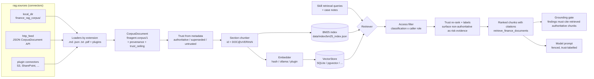

# RAG pipeline



## Live retrieval vs built-in knowledge

- **Policy text is retrieved live on every run** from the index. The matching section text goes into the model prompt and the citations; nothing about the policies is stored in model weights.
- **The index is fixed while the service runs.** Policy changes are maintenance releases ([governance.md](governance.md)); nothing reloads live.
  - **At start-up** the service hashes every local policy file. If anything changed, it rebuilds the keyword index and the vectors (`rag.auto_reindex`).
  - **At start-up** the fine-tuned search model must have been trained on the current corpus (`models/embedder/trained_on.json`). If not, the gated retrain (`scripts/training/retrain.py`) runs (`rag.retrain_on_startup`). If that is off, impossible or fails, search uses BM25 only, never an unverified model.
  - **At start-up** the corpus is compared with the reviewed baseline (`config/policy_baseline.yaml`). Any difference holds every case at DECIDE (`policy.unverified`).
  - Each run records the `index_version` it used.
- **Decisions are re-verified, not just searches:**
  - **At DECIDE**, every cited policy section must still exist with identical text and `current` status; otherwise an approval is downgraded to a hold (`policy.changed_during_run`).
  - **Right before posting** (approval may come hours later), the same check runs again. If the policy changed after approval, **nothing is posted**: the case goes to hold with "governing policy changed after approval" (`policy.changed_since_decision`). `POST /runs/{id}/evidence` then re-evaluates it under the current policy.
- **Remote feeds:** remote feed sources refresh on `finagent ingest`.
- **Policy numbers** the controls use are parameters (`config/policy_parameters.yaml`); changing one is part of a maintenance release.
- **The fine-tuned embedding model** improves *search* over the corpus. It does not store answers. It is retrained at start-up when the corpus changed, or by hand with `make retrain`.

## Ingestion and chunking

- **Corpus:** `finance_rag_corpus/` (15 documents), configured as a `local_dir` source.
  - FIN-POL-001..012 are current internal policy.
  - FIN-POL-003-OLD is **superseded**.
  - ADV-001 (supplier injection) and ADV-002 (irrelevant travel policy) are **untrusted**.
- **Chunking:** one chunk per `##` section, 58 chunks in total. Sections over 1,200 characters split on paragraphs (`.1`, `.2` suffixes).
- **Indexed text:** title, heading and tags are prepended to the section text, so short sections such as "4. Missing receipt" stay retrievable.
- **Chunk ids are citations:** `FIN-POL-002@v2.4#s2`. When a version bump changes the id, old citations stay unambiguous.
- **Index version:** a hash of every document id, version and content hash. It is recorded on every run, so retrieval is reproducible.

## Retrieval strategy

1. **Query planning.**
   - Each skill in the case's plan contributes its curated `retrieval_queries` (see each `skills/<name>/SKILL.md`), so evidence is retrieved for exactly the controls that will run.
   - The case notes are added as one more query, which deliberately lets suspicious text surface labelled documents.
2. **Lexical:** BM25 (k1 1.4, b 0.7) with hyphen splitting and a tiny finance thesaurus.
3. **Vector:** the query embedding is matched against the `VectorStore`, using cosine on normalised vectors.
4. **Fusion (`rag.mode: hybrid`):** weighted Reciprocal Rank Fusion (`k=60`, lexical 1.0, vector 0.5).
   - **Default: `hybrid` with the fine-tuned embedder, vector weight 4.** It is enabled only because it passes the **accuracy gate** (`scripts/training/accuracy_gate.py`, also a permanent test and a `make retrain` step). It must equal or beat BM25 on every measure:

     | Measure | BM25 | Hybrid + fine-tuned |
     |---|---|---|
     | Curated recall (controls' own queries) | 43/43 | 43/43 |
     | Held-out R@1 | 0.47 | **0.62** |
     | Held-out R@5 | 0.71 | **0.90** |
     | MRR | 0.56 | **0.74** |
     | Untrusted ranked first | 0 | 0 |

   - **Fallback:** if the model or library is missing, the service falls back to BM25 and reports it in `/healthz`.
   - **Never use `hash`:** the offline `hash` embedder lowered recall (R@5 0.64) and must not be used with hybrid.
5. **Access control:** chunks whose classification is not allowed for `rag.caller_role` are dropped. For example, `ap_clerk_readonly` cannot see the *restricted* FIN-POL-004.
6. **Trust re-rank.**
   - Superseded chunks ×0.35, untrusted ×0.6, each with a warning.
   - A non-authoritative chunk that would have been in the pre-penalty top-k is still returned, labelled, as **risk evidence**. Hiding it would hide the attack.
7. **Grounding.**
   - Each finding's policy references must resolve to a *retrieved* chunk with `trust=authoritative`. If not, the run records an unknown and downgrades an approval to a hold.
   - The model may cite only ids we supplied, and never non-authoritative ones.

## Quality measures (from `finagent eval`)

| Metric | Value | How |
|---|---|---|
| Skill policy recall@5 | **1.0** (43/43 refs) | for every skill, are its compliance sections retrieved by its own queries? |
| Current over superseded | true | FIN-POL-003 ranks above FIN-POL-003-OLD for authority queries |
| Adversarial labelling | true | ADV-001 is always `untrusted` |
| Citation safety | 0 violations / 42 scenarios | no untrusted or superseded chunk cited as policy authority |
| Grounding gaps | 0 | no ungrounded findings across scenarios |

The fixtures in `tests/unit/test_retrieval.py` cover ranking, labels, access control, citation metadata and vector-store sync.

### What only the embedding model can do

`tests/fixtures/semantic_only_queries.yaml` holds 17 plain-language questions that share no meaningful words with the
policy section that answers them. For example:
- "warning signs that a bill is a scam" → FIN-POL-005 §3, fraud indicators;
- "a lawsuit is pending, can we still purge old files" → FIN-POL-010 §5, legal hold.

None of them appears in the training data or the held-out question set.

| Retrieval | Semantic-only recall@5 |
|---|---|
| Keyword search (BM25) | **0.0** (0/17, by construction) |
| Configured hybrid (fine-tuned bge-small) | **1.0** (17/17) |

- `tests/unit/test_semantic_only.py` checks both sides for every case: BM25 must still miss it (otherwise the case
  proves nothing) and hybrid must find it in the top 5. The tests skip on a machine without the trained model.
- The retrain accuracy gate (`scripts/training/accuracy_gate.py`) rejects any new model below 0.8 on this set.
- **Known fusion gaps (4 cases):** the embedding model alone ranks the right section 1st to 4th, but the hybrid fusion
  pushes it to 6th or 7th. Example: "paying a bill that had no order raised in advance" → FIN-POL-012 §1. These are kept
  as strict expected failures: if a retrain or a fusion change fixes one, the test turns red so the case can be promoted.

## Limitations

- **Hash embeddings are lexical, not semantic.** They hurt recall when fused, which is why `lexical` is the default. Use a fine-tuned (`sentence_transformers`) or pretrained (`ollama`) embedder and compare with `eval_embeddings.py`.
- **Recall on natural questions is lower than on curated queries.** BM25: R@1 0.466, R@5 0.707 on 58 held-out AP-desk questions, versus 1.0 recall@5 for the skills' curated queries. Paraphrased questions are where a trained embedder should help.
- **Curated queries carry part of the recall.** Novel phrasing in case notes relies on BM25 plus vectors only.
- **No cross-encoder re-ranker.** No query rewriting beyond the model's optional 1 extra round (max 2 queries).
- **Section chunking assumes structured policy.** PDFs without headings are chunked per page.
- **Full rebuild on ingest.** Fine at this size; incremental upsert is supported by the `VectorStore` interface, and stale vectors are deleted (`retain_only`) so derived entries follow source deletion (FIN-POL-010 s5).

## Vector store: local by default, dedicated DB when needed

The POC stores embeddings in SQLite (`data/index/vectors.db`): one table, float32 BLOBs, brute-force cosine. It has no extra service, is easy to back up and fast enough for thousands of chunks.

To use a dedicated vector database, implement four methods and register the adapter:

```python
# plugins/pgvector_store.py   (enable: config/workflow.yaml -> plugins: ["plugins.pgvector_store"])
import psycopg
from finagent.rag.vectorstore import VectorStore, register_vector_store

@register_vector_store("pgvector")
class PgVectorStore(VectorStore):
    def __init__(self, settings):
        self.conn = psycopg.connect(settings.get("rag.vector.dsn"))   # e.g. env FINAGENT__RAG__VECTOR__DSN
        self.conn.execute("CREATE EXTENSION IF NOT EXISTS vector")
        self.conn.execute(f"""CREATE TABLE IF NOT EXISTS finagent_vectors (chunk_id text primary key, document_id text,
            classification text, trust text, index_version text, embedder text, embedding vector({settings.get('rag.vector.dim')}))""")
    def upsert(self, items):
        with self.conn.cursor() as cur:
            cur.executemany("""INSERT INTO finagent_vectors VALUES (%s,%s,%s,%s,%s,%s,%s)
                ON CONFLICT (chunk_id) DO UPDATE SET embedding = excluded.embedding, index_version = excluded.index_version""",
                [(i["chunk_id"], i["document_id"], i["classification"], i["trust"], i["index_version"], i["embedder"], i["vector"]) for i in items])
        self.conn.commit(); return len(items)
    def query(self, vector, top_k, filters=None):
        allowed = (filters or {}).get("classification_in")
        sql = "SELECT chunk_id, 1 - (embedding <=> %s::vector) FROM finagent_vectors"
        args = [vector]
        if allowed:
            sql += " WHERE classification = ANY(%s)"; args.append(allowed)
        return self.conn.execute(sql + " ORDER BY embedding <=> %s::vector LIMIT %s", args + [vector, top_k]).fetchall()
    def delete_documents(self, ids):
        return self.conn.execute("DELETE FROM finagent_vectors WHERE document_id = ANY(%s)", [ids]).rowcount
    def stats(self):
        n, v = self.conn.execute("SELECT count(*), max(index_version) FROM finagent_vectors").fetchone()
        return {"store": "pgvector", "vectors": n, "index_version": v, "embedder": None}
```

Then set `rag.vector.store: pgvector` and run `finagent ingest`.

- **OpenSearch k-NN:** same shape, using a `knn_vector` field with a `term` filter on `classification`.
- **Qdrant:** `upsert` points with payload `{document_id, classification, trust}` and `search` with a `Filter`.

Access filtering and trust re-ranking stay in the retriever, so security behaviour is identical whichever store you use.
