# Workflow scenarios

_Generated from `scripts/workflow_catalog.py` by `python scripts/build_workflow_pdf.py`; the PDF version (one page per scenario) is [diagrams/workflow_scenarios.pdf](diagrams/workflow_scenarios.pdf)._

| # | Scenario | Business meaning |
|---|---|---|
| A | [Standard invoice: approved and posted once](#a-standard-invoice-approved-and-posted-once) | Everything matches the purchase order, the delivery and the supplier record. The system recommends payment, an authorised person approves, and the invoice is posted exactly once. |
| B | [Higher-risk invoice: two approvals required](#b-higher-risk-invoice-two-approvals-required) | Payments to a brand-new supplier, a changed or overseas bank account, or very large amounts need a second approval from Financial Control (and the right seniority) before anything is posted. |
| C | [Approval refused by the system (wrong person)](#c-approval-refused-by-the-system-wrong-person) | The system checks every approver: authority limit, valid delegation and conflicts of interest. An approver who is not allowed is refused with the reason; the request stays open for the right person. |
| D | [Approver rejects the recommendation](#d-approver-rejects-the-recommendation) | A person can always say no. A rejection must include a reason; nothing is posted and the case returns to Accounts Payable. |
| E | [Approval sent twice (duplicate click or retry)](#e-approval-sent-twice-duplicate-click-or-retry) | Approval systems sometimes deliver the same message twice. The second delivery gets the same answer and does nothing - the invoice can never be posted twice. |
| F | [Duplicate invoice: rejection confirmed](#f-duplicate-invoice-rejection-confirmed) | The same invoice (same supplier, number and amount) was already paid. The system recommends rejecting it; a person confirms, and the rejection is recorded - nothing is paid. |
| G | [Invalid invoice: addressed to another company](#g-invalid-invoice-addressed-to-another-company) | An invoice billed to a different legal entity is not Northstar's obligation. The system recommends rejecting it as invalid; a person confirms. |
| H | [Held: the invoice does not match](#h-held-the-invoice-does-not-match) | Something on the invoice does not agree with the order or delivery. Payment is held and the exact problem (expected value, actual value, policy rule) is sent to the person who can fix it. |
| I | [Held: evidence missing or a system is down](#i-held-evidence-missing-or-a-system-is-down) | The system never guesses. If the order system does not answer or there is no delivery record, it retries, then holds the invoice and lists exactly what is missing. |
| J | [Held: supplier problem](#j-held-supplier-problem) | Payments only go to suppliers in good standing. Blocked, dormant, unverified or sanctions-review suppliers, a bank change in the last two business days, or stale sanctions screening put the invoice on hold. |
| K | [Escalated: suspicious invoice](#k-escalated-suspicious-invoice) | Two or more fraud signals - hidden instructions, urgency, new bank details, look-alike e-mail domain, unknown contact number - send the case to the Financial Crime team. The supplier is not told. Nothing can be paid. |
| L | [AI problems never relax the decision](#l-ai-problems-never-relax-the-decision) | The AI answers the skills' judgement questions and writes the explanation, but it can only make a decision more cautious. A malformed explanation is retried, then replaced by safe standard wording; an attempt to relax a decision is blocked. |
| M | [No purchase order: permitted and not permitted](#m-no-purchase-order-permitted-and-not-permitted) | Invoices without a purchase order are allowed only for utilities, leases, statutory charges, memberships and real emergencies, with internal proof of service. Poor planning is not an emergency; repeated use is escalated. |
| N | [Credit notes and foreign currency](#n-credit-notes-and-foreign-currency) | Credit notes must refer to a real earlier invoice from the same supplier and currency. Foreign-currency invoices are converted at the company's daily rate only to decide who may approve. |
| O | [New evidence: the case is re-assessed](#o-new-evidence-the-case-is-re-assessed) | When the missing information arrives, the case is re-run as a new attempt. Every check runs again on fresh data; the previous result is kept for audit. |
| P | [Policy changed after approval: posting blocked](#p-policy-changed-after-approval-posting-blocked) | Approval may come hours later. Right before posting, the system re-reads the policy sections the decision relied on. If any changed or was deleted, nothing is posted and the case is re-assessed under the current policy. |
| Q | [Crash and recovery](#q-crash-and-recovery) | Progress is saved after every step. If the application stops, the case continues from where it was - and a posting is never repeated. |
| R | [Request rejected at the door](#r-request-rejected-at-the-door) | Malformed or hostile requests are refused before any work starts - including attempts to smuggle in fields such as 'approved_by_cfo'. |
| S | [Policy change: a maintenance release](#s-policy-change-a-maintenance-release) | A policy change is never applied live. Finance changes the policy, the checks are updated and tested, a named person records the reviewed policy text, and the service is restarted. A running service never changes its rules. |
| T | [Policy changed but not re-baselined: every case held](#t-policy-changed-but-not-re-baselined-every-case-held) | If the service starts with policy text that differs from the reviewed baseline, the checks may not match the policy any more. Nothing is approved: every case is held until the maintenance release is finished. |
| U | [Search model older than the policy: retrain or keyword search](#u-search-model-older-than-the-policy-retrain-or-keyword-search) | The fine-tuned search model must have been trained on the current policy library. If not, it is retrained at start-up and kept only if it passes the accuracy test. If that is off or fails, the service uses keyword search only - never an unverified model. |
| V | [Judgement catches what rules miss](#v-judgement-catches-what-rules-miss) | On top of exact code checks, four skills ask the AI fixed questions; code decides what each answer means. It catches what fixed rules miss - a planning failure described as an 'emergency', polite social engineering, a different item under the same code - and can only add caution: hold, escalate or a visible warning. |
| W | [Judgement questions that cannot be answered hold the case](#w-judgement-questions-that-cannot-be-answered-hold-the-case) | If the AI is unavailable or its answers break the rules (not one of the allowed answers, a quote that is not in the documents), it is asked once to correct them, then the larger model is asked; if that also fails, the case is held - never silently approved. |

## A. Standard invoice: approved and posted once

**Business meaning.** Everything matches the purchase order, the delivery and the supplier record. The system recommends payment, an authorised person approves, and the invoice is posted exactly once.

**When it happens.** PO-backed invoice; prices, quantities, tax within tolerance; supplier active; no duplicate; amount within one approver's limit.

```mermaid
flowchart LR
  N0["1. Request<br/><small>API / CLI</small>"]
  N1["2. Read documents<br/><small>PDF, e-mail, CSV, JSON</small>"]
  N0 --> N1
  N2["3. Find policy<br/><small>search the policy library</small>"]
  N1 --> N2
  N3["4. Gather facts<br/><small>vendor, PO, history, limits</small>"]
  N2 --> N3
  N4["5. 11 checks pass<br/><small>exact decimal maths</small>"]
  N3 --> N4
  N5["6. AI explains<br/><small>cited summary</small>"]
  N4 --> N5
  N6["7. Approval request<br/><small>right role, with explanation</small>"]
  N5 --> N6
  N7["8. Approver says yes<br/><small>limit checked</small>"]
  N6 --> N7
  N8["9. Policy re-checked<br/><small>unchanged since decision</small>"]
  N7 --> N8
  N9(["10. Posted once<br/><small>SIM-POST reference</small>"])
  N8 --> N9
```

**Outcome.**

- Run COMPLETED, outcome pool SUBMITTED
- Webhooks: approval.requested, decision.submitted, run.completed
- Next: payment run on the proposed date

**Example test cases.** FIN-001, FIN-007, FIN-017, FIN-026, FIN-039, FIN-042

**Evidence in the logs.** approval.requested -> approval.decision_recorded -> tool.call submit_finance_decision -> run.completed

## B. Higher-risk invoice: two approvals required

**Business meaning.** Payments to a brand-new supplier, a changed or overseas bank account, or very large amounts need a second approval from Financial Control (and the right seniority) before anything is posted.

**When it happens.** Supplier < 30 days old; first payment after a bank change; overseas account; non-PO above AUD 10k (Procurement).

```mermaid
flowchart LR
  N0["1. Request<br/><small>API / CLI</small>"]
  N1["2. Read documents<br/><small>PDF, e-mail, CSV, JSON</small>"]
  N0 --> N1
  N2["3. Find policy<br/><small>search the policy library</small>"]
  N1 --> N2
  N3["4. Gather facts<br/><small>vendor, PO, history, limits</small>"]
  N2 --> N3
  N4["5. Checks pass<br/><small>high-risk flags raised</small>"]
  N3 --> N4
  N5["6. Approval request<br/><small>2 slots: primary + Financial Control</small>"]
  N4 --> N5
  N6["7. 1st approver<br/><small>fills one slot; still pending</small>"]
  N5 --> N6
  N7["8. 2nd approver<br/><small>fills the other slot</small>"]
  N6 --> N7
  N8(["9. Posted once<br/><small>after BOTH approvals</small>"])
  N7 --> N8
```

**Outcome.**

- Stays AWAITING_APPROVAL until every slot is filled
- Run COMPLETED, pool SUBMITTED
- The same person can never fill two slots

**Example test cases.** FIN-012, FIN-013, FIN-034, FIN-050, FIN-051

**Evidence in the logs.** approval.decision_recorded (status PENDING, remaining slots) -> approval.resolved APPROVED

## C. Approval refused by the system (wrong person)

**Business meaning.** The system checks every approver: authority limit, valid delegation and conflicts of interest. An approver who is not allowed is refused with the reason; the request stays open for the right person.

**When it happens.** Limit too low; expired delegation; approver created the supplier; requester / goods receiver approving > AUD 25k.

```mermaid
flowchart LR
  N0["1. Request<br/><small>API / CLI</small>"]
  N1["2. Read documents<br/><small>PDF, e-mail, CSV, JSON</small>"]
  N0 --> N1
  N2["3. Find policy<br/><small>search the policy library</small>"]
  N1 --> N2
  N3["4. Gather facts<br/><small>vendor, PO, history, limits</small>"]
  N2 --> N3
  N4["5. Checks pass"]
  N3 --> N4
  N5["6. Approval request"]
  N4 --> N5
  N6["7. Wrong approver<br/><small>tries to approve</small>"]
  N5 --> N6
  N7["8. 403 refused<br/><small>reason recorded</small>"]
  N6 --> N7
  N8["9. Right approver<br/><small>approves</small>"]
  N7 --> N8
  N9(["10. Posted once"])
  N8 --> N9
```

**Outcome.**

- Refusal is logged and visible in the reasoning trace
- Run completes only with a valid approver

**Example test cases.** FIN-001 (limit), FIN-018 (CFO needed), FIN-024 (created supplier), FIN-029 (expired delegation)

**Evidence in the logs.** approval.denied (forbidden) with reasons; HUMAN_DECISION 'REFUSED by system' in finagent explain

## D. Approver rejects the recommendation

**Business meaning.** A person can always say no. A rejection must include a reason; nothing is posted and the case returns to Accounts Payable.

**When it happens.** Approver disagrees with the recommendation (any case waiting for approval).

```mermaid
flowchart LR
  N0["1. Request<br/><small>API / CLI</small>"]
  N1["2. Read documents<br/><small>PDF, e-mail, CSV, JSON</small>"]
  N0 --> N1
  N2["3. Find policy<br/><small>search the policy library</small>"]
  N1 --> N2
  N3["4. Gather facts<br/><small>vendor, PO, history, limits</small>"]
  N2 --> N3
  N4["5. Checks pass"]
  N3 --> N4
  N5["6. Approval request"]
  N4 --> N5
  N6["7. Approver says no<br/><small>reason required</small>"]
  N5 --> N6
  N7(["8. Nothing posted<br/><small>FINALIZE_REJECTED</small>"])
  N6 --> N7
```

**Outcome.**

- Run COMPLETED, pool REJECTED_BY_APPROVER
- Late or repeated decisions have no effect (409 / replay)

**Example test cases.** FIN-027, FIN-049, FIN-055

**Evidence in the logs.** approval.resolved REJECTED -> run.completed (approval_rejected); no submit_finance_decision call

## E. Approval sent twice (duplicate click or retry)

**Business meaning.** Approval systems sometimes deliver the same message twice. The second delivery gets the same answer and does nothing - the invoice can never be posted twice.

**When it happens.** Same callback id delivered again; or a second approver after the approval is already resolved.

```mermaid
flowchart LR
  N0["1. Request<br/><small>API / CLI</small>"]
  N1["2. Read documents<br/><small>PDF, e-mail, CSV, JSON</small>"]
  N0 --> N1
  N2["3. Find policy<br/><small>search the policy library</small>"]
  N1 --> N2
  N3["4. Gather facts<br/><small>vendor, PO, history, limits</small>"]
  N2 --> N3
  N4["5. Approval request"]
  N3 --> N4
  N5["6. Approval #1<br/><small>recorded, posted once</small>"]
  N4 --> N5
  N6["7. Approval #1 again<br/><small>same callback id</small>"]
  N5 --> N6
  N7(["8. Replayed<br/><small>same response, no effect</small>"])
  N6 --> N7
```

**Outcome.**

- Exactly one posting
- Later conflicting decision -> 409, no effect

**Example test cases.** FIN-005, FIN-059

**Evidence in the logs.** approval.callback_replayed; approval.duplicate_ignored (conflict)

## F. Duplicate invoice: rejection confirmed

**Business meaning.** The same invoice (same supplier, number and amount) was already paid. The system recommends rejecting it; a person confirms, and the rejection is recorded - nothing is paid.

**When it happens.** Exact match with a PAID or POSTED invoice (even if the supplier is also blocked).

```mermaid
flowchart LR
  N0["1. Request<br/><small>API / CLI</small>"]
  N1["2. Read documents<br/><small>PDF, e-mail, CSV, JSON</small>"]
  N0 --> N1
  N2["3. Find policy<br/><small>search the policy library</small>"]
  N1 --> N2
  N3["4. Gather facts<br/><small>vendor, PO, history, limits</small>"]
  N2 --> N3
  N4["5. Duplicate found<br/><small>matches paid record</small>"]
  N3 --> N4
  N5["6. Reject recommended<br/><small>never payment</small>"]
  N4 --> N5
  N6["7. Approver confirms"]
  N5 --> N6
  N7(["8. Rejection recorded<br/><small>SIM-REJECT reference</small>"])
  N6 --> N7
```

**Outcome.**

- Run COMPLETED, pool SUBMITTED (decision = REJECT)
- Near-duplicates and re-submitted rejected invoices are HELD instead

**Example test cases.** FIN-002, FIN-043 (blocked + duplicate); near-duplicates: FIN-009, FIN-031, FIN-048

**Evidence in the logs.** duplicate_detection votes REJECT_DUPLICATE; ERP decision REJECT

## G. Invalid invoice: addressed to another company

**Business meaning.** An invoice billed to a different legal entity is not Northstar's obligation. The system recommends rejecting it as invalid; a person confirms.

**When it happens.** Bill-to is not a Northstar entity; credit note referencing an unknown invoice combined with wrong entity.

```mermaid
flowchart LR
  N0["1. Request<br/><small>API / CLI</small>"]
  N1["2. Read documents<br/><small>PDF, e-mail, CSV, JSON</small>"]
  N0 --> N1
  N2["3. Find policy<br/><small>search the policy library</small>"]
  N1 --> N2
  N3["4. Gather facts<br/><small>vendor, PO, history, limits</small>"]
  N2 --> N3
  N4["5. Entity check fails<br/><small>bill-to mismatch</small>"]
  N3 --> N4
  N5["6. Reject (invalid)<br/><small>outranks a hold</small>"]
  N4 --> N5
  N6["7. Approver decides<br/><small>confirm or decline</small>"]
  N5 --> N6
  N7(["8. Recorded<br/><small>nothing paid</small>"])
  N6 --> N7
```

**Outcome.**

- REJECT_INVALID awaiting approval; then COMPLETED

**Example test cases.** FIN-033, FIN-049

**Evidence in the logs.** evidence_completeness votes REJECT_INVALID

## H. Held: the invoice does not match

**Business meaning.** Something on the invoice does not agree with the order or delivery. Payment is held and the exact problem (expected value, actual value, policy rule) is sent to the person who can fix it.

**When it happens.** Price above tolerance; more billed than received; unreceipted line; unapproved freight; wrong tax; currency mismatch; request amount, PO, invoice number or currency differs from the document.

```mermaid
flowchart LR
  N0["1. Request<br/><small>API / CLI</small>"]
  N1["2. Read documents<br/><small>PDF, e-mail, CSV, JSON</small>"]
  N0 --> N1
  N2["3. Find policy<br/><small>search the policy library</small>"]
  N1 --> N2
  N3["4. Gather facts<br/><small>vendor, PO, history, limits</small>"]
  N2 --> N3
  N4["5. Check fails<br/><small>e.g. +150 over a 50 limit</small>"]
  N3 --> N4
  N5["6. AI explains"]
  N4 --> N5
  N6["7. Held<br/><small>owner + review date</small>"]
  N5 --> N6
  N7["8. Owner fixes<br/><small>new evidence</small>"]
  N6 --> N7
```

**Outcome.**

- Run NEEDS_INFORMATION, pool HELD
- Webhook run.needs_information; no approval request; nothing can be posted

**Example test cases.** FIN-006, FIN-008, FIN-014, FIN-023, FIN-032, FIN-048, FIN-052, FIN-078, FIN-079, FIN-080

**Evidence in the logs.** three_way_match / evidence_completeness vote HOLD; failing calculation recorded

## I. Held: evidence missing or a system is down

**Business meaning.** The system never guesses. If the order system does not answer or there is no delivery record, it retries, then holds the invoice and lists exactly what is missing.

**When it happens.** PO service timeout; no goods receipt (a 'delivered' note on the invoice is not proof); no invoice attached; unreadable attachments; no exchange rate.

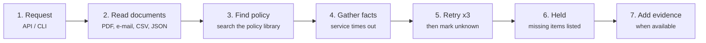

**Outcome.**

- Run NEEDS_INFORMATION, pool HELD
- Unknowns list what is missing and how to resolve it

**Example test cases.** FIN-004, FIN-041, FIN-045, FIN-046, FIN-054

**Evidence in the logs.** tool.call retrying / failed; unknowns in the result; GATHER_EVIDENCE 'FAILED' in the reasoning trace

## J. Held: supplier problem

**Business meaning.** Payments only go to suppliers in good standing. Blocked, dormant, unverified or sanctions-review suppliers, a bank change in the last two business days, or stale sanctions screening put the invoice on hold.

**When it happens.** Supplier status not ACTIVE; bank changed < 2 business days ago; overseas screening older than 24 h.

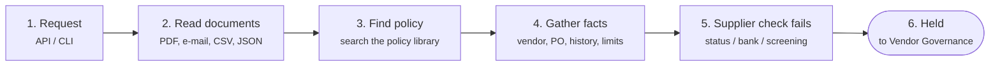

**Outcome.**

- Run NEEDS_INFORMATION, pool HELD

**Example test cases.** FIN-010, FIN-011, FIN-025, FIN-036, FIN-037, FIN-053

**Evidence in the logs.** vendor_compliance votes HOLD (VENDOR_BLOCK / BANK_CHANGE)

## K. Escalated: suspicious invoice

**Business meaning.** Two or more fraud signals - hidden instructions, urgency, new bank details, look-alike e-mail domain, unknown contact number - send the case to the Financial Crime team. The supplier is not told. Nothing can be paid.

**When it happens.** Prompt injection in documents or notes; changed bank details; urgency; unusual domain; repeated non-PO use.

```mermaid
flowchart LR
  N0["1. Request<br/><small>API / CLI</small>"]
  N1["2. Read documents<br/><small>PDF, e-mail, CSV, JSON</small>"]
  N0 --> N1
  N2["3. Find policy<br/><small>search the policy library</small>"]
  N1 --> N2
  N3["4. Gather facts<br/><small>vendor, PO, history, limits</small>"]
  N2 --> N3
  N4["5. Screen text<br/><small>hidden instructions flagged</small>"]
  N3 --> N4
  N5["6. Count signals<br/><small>2 or more</small>"]
  N4 --> N5
  N6["7. AI cannot override<br/><small>proposal to pay is blocked</small>"]
  N5 --> N6
  N7(["8. Escalated<br/><small>Financial Crime team</small>"])
  N6 --> N7
```

**Outcome.**

- Run NEEDS_INFORMATION, pool ESCALATED
- No approval request; posting impossible

**Example test cases.** FIN-003, FIN-035, FIN-044, FIN-056, FIN-057

**Evidence in the logs.** fraud_indicator_scoring votes ESCALATE; model.override_blocked when the AI was fooled

## L. AI problems never relax the decision

**Business meaning.** The AI answers the skills' judgement questions and writes the explanation, but it can only make a decision more cautious. A malformed explanation is retried, then replaced by safe standard wording; an attempt to relax a decision is blocked.

**When it happens.** Malformed AI output; AI proposes approval on a risky case; AI raises a concern on a clean case.

```mermaid
flowchart LR
  N0["1. Request<br/><small>API / CLI</small>"]
  N1["2. Read documents<br/><small>PDF, e-mail, CSV, JSON</small>"]
  N0 --> N1
  N2["3. Find policy<br/><small>search the policy library</small>"]
  N1 --> N2
  N3["4. Gather facts<br/><small>vendor, PO, history, limits</small>"]
  N2 --> N3
  N4["5. Checks decide<br/><small>rules outcome</small>"]
  N3 --> N4
  N5["6. AI drafts<br/><small>invalid / unsafe / cautious</small>"]
  N4 --> N5
  N6["7. Validator + guard<br/><small>re-ask, block, or accept caution</small>"]
  N5 --> N6
  N7(["8. Decision stands<br/><small>or becomes more cautious</small>"])
  N6 --> N7
```

**Outcome.**

- Processing never stops because of the AI
- AI escalation of a clean case -> ESCALATED (allowed)

**Example test cases.** FIN-020 (retry fixes it), FIN-047 (always broken -> fallback), FIN-003/044 (blocked), FIN-058 (escalates)

**Evidence in the logs.** model.call invalid_output; model.fallback; model.override_blocked; model.escalation_adopted

## M. No purchase order: permitted and not permitted

**Business meaning.** Invoices without a purchase order are allowed only for utilities, leases, statutory charges, memberships and real emergencies, with internal proof of service. Poor planning is not an emergency; repeated use is escalated.

**When it happens.** No PO reference on the invoice.

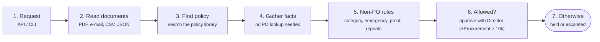

**Outcome.**

- Permitted -> approval path (Director level)
- Not permitted -> HELD (MISSING_PO); repeated -> ESCALATED

**Example test cases.** FIN-015, FIN-050 (allowed); FIN-016, FIN-038 (held); FIN-035, FIN-056 (escalated)

**Evidence in the logs.** non_po_validation findings; PLAN 'skip three_way_match' in the reasoning trace

## N. Credit notes and foreign currency

**Business meaning.** Credit notes must refer to a real earlier invoice from the same supplier and currency. Foreign-currency invoices are converted at the company's daily rate only to decide who may approve.

**When it happens.** document_type credit_note; invoice currency not AUD.

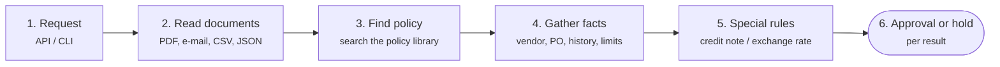

**Outcome.**

- Valid credit note -> approval; unknown original -> HOLD
- No corporate rate -> HOLD; overseas bank -> + Financial Control

**Example test cases.** FIN-019 (credit), FIN-013 (USD), FIN-014 (currency mismatch), FIN-045 (no rate)

**Evidence in the logs.** credit_note_validation / fx_validation findings; amount_in_aud calculation

## O. New evidence: the case is re-assessed

**Business meaning.** When the missing information arrives, the case is re-run as a new attempt. Every check runs again on fresh data; the previous result is kept for audit.

**When it happens.** POST /runs/{id}/evidence on a held, escalated or failed case.

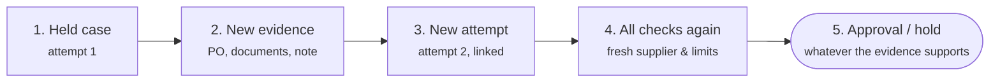

**Outcome.**

- Old attempt unchanged; new attempt follows the normal flow

**Example test cases.** FIN-038 (fixed), FIN-060 (still held)

**Evidence in the logs.** evidence.received; parent_run_id on the new run

## P. Policy changed after approval: posting blocked

**Business meaning.** Approval may come hours later. Right before posting, the system re-reads the policy sections the decision relied on. If any changed or was deleted, nothing is posted and the case is re-assessed under the current policy.

**When it happens.** Policy file edited, deleted or superseded between the decision and the posting.

```mermaid
flowchart LR
  N0["1. Request<br/><small>API / CLI</small>"]
  N1["2. Read documents<br/><small>PDF, e-mail, CSV, JSON</small>"]
  N0 --> N1
  N2["3. Find policy<br/><small>search the policy library</small>"]
  N1 --> N2
  N3["4. Gather facts<br/><small>vendor, PO, history, limits</small>"]
  N2 --> N3
  N4["5. Checks pass"]
  N3 --> N4
  N5["6. Approval request"]
  N4 --> N5
  N6["7. Policy edited<br/><small>e.g. tolerance 50 -> 75</small>"]
  N5 --> N6
  N7["8. Approver says yes"]
  N6 --> N7
  N8["9. Policy re-check<br/><small>text changed</small>"]
  N7 --> N8
  N9(["10. Posting blocked<br/><small>held; re-assess</small>"])
  N8 --> N9
```

**Outcome.**

- Run NEEDS_INFORMATION, pool HELD; approval kept, nothing posted
- Re-assess with POST /runs/{id}/evidence

**Example test cases.** pytest tests/contract/test_policy_freshness.py (edits the policy files, so it runs as a test, not a scenario)

**Evidence in the logs.** policy.changed_since_decision (blocked); policy.changed_during_run

## Q. Crash and recovery

**Business meaning.** Progress is saved after every step. If the application stops, the case continues from where it was - and a posting is never repeated.

**When it happens.** Process crash or restart mid-case, or between approval and posting.

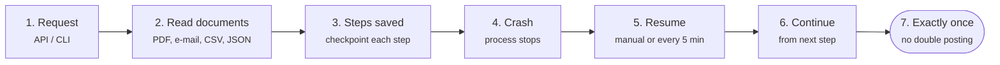

**Outcome.**

- Same run continues; same result as without the crash

**Example test cases.** FIN-022, FIN-059

**Evidence in the logs.** run.simulated_crash; run.resumed; run.resume_noop

## R. Request rejected at the door

**Business meaning.** Malformed or hostile requests are refused before any work starts - including attempts to smuggle in fields such as 'approved_by_cfo'.

**When it happens.** Negative amount; bad currency or case id; unknown fields; more than 10 attachments.

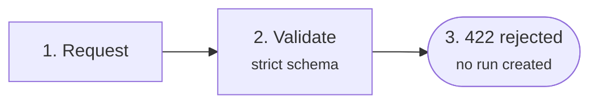

**Outcome.**

- HTTP 422 with the reasons; nothing stored as a case

**Example test cases.** FIN-028, FIN-061, FIN-062, FIN-063

**Evidence in the logs.** request validation error returned to the caller

## S. Policy change: a maintenance release

**Business meaning.** A policy change is never applied live. Finance changes the policy, the checks are updated and tested, a named person records the reviewed policy text, and the service is restarted. A running service never changes its rules.

**When it happens.** New, edited or deleted policy document in finance_rag_corpus/.

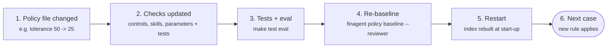

**Outcome.**

- config/policy_baseline.yaml records reviewer, date and section texts
- /healthz shows "policy": "ok"

**Example test cases.** pytest tests/contract/test_policy_freshness.py::test_maintenance_rebaseline_restores_normal_processing

**Evidence in the logs.** no event for the release itself; each run records the index version and the policy snapshot

## T. Policy changed but not re-baselined: every case held

**Business meaning.** If the service starts with policy text that differs from the reviewed baseline, the checks may not match the policy any more. Nothing is approved: every case is held until the maintenance release is finished.

**When it happens.** Policy file changed and the service restarted without finagent policy baseline.

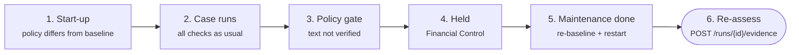

**Outcome.**

- Run NEEDS_INFORMATION, pool HELD, exception OTHER_CONTROL_RISK; result.policy lists the unverified sections
- /healthz shows "policy": "maintenance_required"

**Example test cases.** pytest tests/contract/test_policy_freshness.py::test_restart_with_unverified_policy_holds_every_case

**Evidence in the logs.** policy.unverified (DECIDE)

## U. Search model older than the policy: retrain or keyword search

**Business meaning.** The fine-tuned search model must have been trained on the current policy library. If not, it is retrained at start-up and kept only if it passes the accuracy test. If that is off or fails, the service uses keyword search only - never an unverified model.

**When it happens.** Policy corpus changed since models/embedder/trained_on.json was written.

```mermaid
flowchart LR
  N0["1. Start-up<br/><small>corpus changed</small>"]
  N1["2. Retrain<br/><small>scripts/training/retrain.py (gated)</small>"]
  N0 --> N1
  N2["3. Passes?<br/><small>accuracy gate</small>"]
  N1 --> N2
  N3["4. New model used"]
  N2 --> N3
  N4(["5. Otherwise<br/><small>keyword search (BM25) only</small>"])
  N3 --> N4
```

**Outcome.**

- /healthz shows the search mode; degraded reason when BM25 only
- Setting rag.retrain_on_startup (default true)

**Example test cases.** pytest tests/unit/test_search_accuracy.py::test_startup_with_changed_corpus_never_uses_an_unverified_model

**Evidence in the logs.** start-up log lines [finagent] ... search model

## V. Judgement catches what rules miss

**Business meaning.** On top of exact code checks, four skills ask the AI fixed questions; code decides what each answer means. It catches what fixed rules miss - a planning failure described as an 'emergency', polite social engineering, a different item under the same code - and can only add caution: hold, escalate or a visible warning.

**When it happens.** Wording the keyword rules do not know; intent hidden in polite text; item or unit changes under the same SKU.

```mermaid
flowchart LR
  N0["1. Request"]
  N1["2. Read documents"]
  N0 --> N1
  N2["3. Code check passes<br/><small>maths, matching, keywords</small>"]
  N1 --> N2
  N3["4. AI answers questions<br/><small>small model; large on concern</small>"]
  N2 --> N3
  N4["5. Checked by code<br/><small>answer allowed, quote exists</small>"]
  N3 --> N4
  N5["6. Held / escalated<br/><small>with the reason</small>"]
  N4 --> N5
  N6["7. Evidence arrives<br/><small>e.g. incident record</small>"]
  N5 --> N6
  N7(["8. Re-assessed<br/><small>approved if supported</small>"])
  N6 --> N7
```

**Outcome.**

- Case HELD or ESCALATED with the answers as the reason, or approved with a warning (FLAG)
- Scripts alone would have sent these cases to approval

**Example test cases.** FIN-064 (fake emergency), FIN-065 (social engineering), FIN-066 (pack size), FIN-068 (late-fee pressure); harder: FIN-069 (three concerns), FIN-070 (instructions to the AI), FIN-071 (conflicting evidence), FIN-072 (buried)

**Evidence in the logs.** skill.procedure (verdict HOLD / ESCALATE / FLAG, decided_by small / large); reasoning 'skill:<name> (questions)'

## W. Judgement questions that cannot be answered hold the case

**Business meaning.** If the AI is unavailable or its answers break the rules (not one of the allowed answers, a quote that is not in the documents), it is asked once to correct them, then the larger model is asked; if that also fails, the case is held - never silently approved.

**When it happens.** Model down or timing out; invalid answers from both models; model-call budget exhausted.

```mermaid
flowchart LR
  N0["1. Request"]
  N1["2. Code check"]
  N0 --> N1
  N2["3. Small model<br/><small>invalid answers</small>"]
  N1 --> N2
  N3["4. Repair round<br/><small>errors sent back</small>"]
  N2 --> N3
  N4["5. Large model<br/><small>still invalid</small>"]
  N3 --> N4
  N5["6. Held<br/><small>questions not answered</small>"]
  N4 --> N5
  N6["7. Re-run<br/><small>model available</small>"]
  N5 --> N6
  N7(["8. Normal flow"])
  N6 --> N7
```

**Outcome.**

- Run NEEDS_INFORMATION: 'judgement questions not answered'; re-run with POST /runs/{id}/evidence

**Example test cases.** FIN-067; tests/unit/test_skill_packs.py

**Evidence in the logs.** skill.procedure (status invalid / failed / budget)
